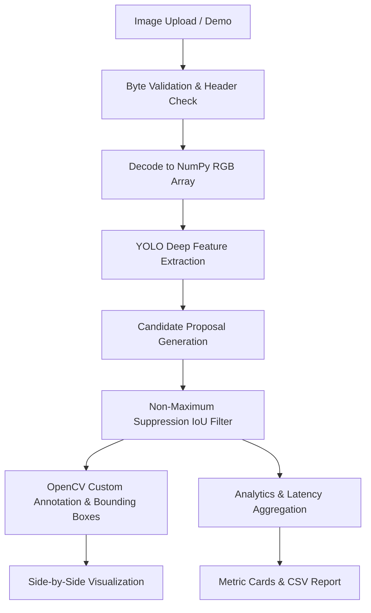

# VisionGuard AI — Real-Time Object Detection System 🛡️

VisionGuard AI is a portfolio-grade computer vision web application built for real-time object detection, classification, and spatial analytics. Engineered with **Ultralytics YOLO (YOLO11 / YOLOv8)**, **OpenCV**, and **Streamlit**, VisionGuard provides an interactive dashboard capable of processing uploaded images, drawing high-contrast bounding boxes, performing Non-Maximum Suppression (NMS), calculating detection latency, and exporting analytics reports.

---

## 🌟 Key Features

- **Genuine Neural Inference:** Uses real pretrained Ultralytics YOLO models (`yolo11n.pt` / `yolov8n.pt`) trained on the COCO dataset (80 object classes).
- **CPU-Optimized Execution:** Runs on consumer Windows PCs without requiring dedicated NVIDIA CUDA hardware.
- **Dynamic Preprocessing & Color Pipeline:** Robust byte validation and strict color-space management between OpenCV (BGR) and Pillow/Streamlit (RGB).
- **Interactive Configuration:**
  - Real-time **Confidence Threshold** adjustment (5% to 100%).
  - Configurable **Intersection-over-Union (IoU)** threshold for Non-Maximum Suppression.
  - Granular **Class Filtering** to isolate targets (e.g., only detect `person` and `car`).
- **Telemetry & Latency Monitoring:**
  - True neural model forward-pass measurement.
  - End-to-end pipeline latency tracking.
- **Side-by-Side Visual Comparison:** Compare the pristine original upload directly against the annotated output.
- **Data Export & Reporting:**
  - Download high-resolution annotated images as **PNG**.
  - Export structured detection coordinates $(x_1, y_1, x_2, y_2)$, width, height, and confidence scores as **CSV**.
- **Automated Test Suite:** Unit tests for image validation, color transformations, analytics aggregation, and serialization.

---

## 🏗️ Architecture & Project Structure

```
VisionGuard-AI/
├── app.py                      # Main Streamlit web application & UI dashboard
├── requirements.txt            # Project dependencies
├── README.md                   # Technical documentation & project guide
├── .gitignore                  # Git exclusions for models, cache, and virtualenvs
├── src/
│   ├── __init__.py             # Package initializer
│   ├── detector.py             # Ultralytics YOLO inference wrapper & OpenCV annotator
│   ├── image_processor.py      # Byte validation, decoding, and BGR <-> RGB conversions
│   ├── analytics.py            # Summary calculations, class frequency, and DataFrames
│   └── export_utils.py         # CSV serialization & PNG byte export
├── tests/
│   ├── __init__.py             # Test suite initializer
│   ├── test_image_processor.py # Unit tests for image validation and color spaces
│   └── test_analytics.py       # Unit tests for analytics, DataFrames, and exports
├── assets/
│   └── .gitkeep                # Visual assets and project diagrams
└── outputs/
    └── .gitkeep                # Temporary storage for test exports
```

---

## ⚙️ Technology Stack

| Technology | Role | Description |
|---|---|---|
| **Python 3.10–3.12** | Runtime | Core programming language |
| **Ultralytics YOLO** | Deep Learning | Single-stage neural object detection engine |
| **OpenCV (`opencv-python`)** | Image Processing | Bounding-box rendering, typography badges, color transformations |
| **Streamlit** | Frontend UI | Reactive, interactive web dashboard |
| **Pillow (PIL)** | Image I/O | Header verification, image decoding, and format conversion |
| **NumPy** | Numerical Matrix Ops | Fast array slicing and color matrix manipulations |
| **Pandas** | Data Analytics | Tabular detection aggregation, summary grouping, and CSV export |
| **Pytest / Unittest** | Testing | Automated test verification |

---

## 🚀 Quickstart & Installation (Windows)

### 1. Prerequisites
Ensure you have **Python 3.10, 3.11, or 3.12** installed on your Windows machine:
```powershell
python --version
```

### 2. Set Up Virtual Environment
Open PowerShell inside the project directory:
```powershell
# Create a virtual environment named .venv
python -m venv .venv

# Activate the virtual environment
.venv\Scripts\Activate.ps1
```
*(If PowerShell restricts script execution, run `Set-ExecutionPolicy -ExecutionPolicy RemoteSigned -Scope CurrentUser`)*

### 3. Install Dependencies
```powershell
python -m pip install --upgrade pip
pip install -r requirements.txt
```

### 4. Run Automated Tests
Verify all core modules before starting the server:
```powershell
python -m unittest discover tests
```

### 5. Launch the Web Application
```powershell
streamlit run app.py
```
Your default web browser will automatically open to `http://localhost:8501`.

---

## 🧠 How the Computer Vision Pipeline Works



1. **Validation & Ingestion:**
   Raw byte headers are inspected using `Pillow.Image.verify()` to eliminate truncated, corrupt, or malicious payloads before any raster decompression.
2. **Color Space Management:**
   OpenCV natively decodes pixel buffers in **BGR** order due to historic camera hardware conventions. Pillow and browsers use **RGB**. VisionGuard enforces explicit conversion routines to eliminate color-shift bugs.
3. **Neural Prediction:**
   The image tensor is evaluated by the YOLO backbone and feature pyramid network (FPN/PAN), outputting bounding-box coordinates $(x_1, y_1, x_2, y_2)$ and class confidence scores.
4. **Non-Maximum Suppression (NMS):**
   Dense candidate bounding boxes with an Intersection-over-Union (IoU) greater than the threshold are suppressed, retaining only the maximum confidence prediction per object.
5. **Annotation & Telemetry:**
   OpenCV renders bounding boxes with high-contrast label badges and baseline padding. Execution time is recorded using high-resolution monotonic clocks (`time.perf_counter()`).

---

## 🔬 Model Limitations & Edge Cases

- **Small Object Sensitivity:** Compact nano architectures (`yolo11n`, `yolov8n`) prioritize latency and memory efficiency, which can occasionally miss tiny or heavily occluded objects in distant views.
- **COCO Class Boundaries:** The default model recognizes 80 distinct common categories (people, vehicles, animals, common household items). Specialized domain targets (e.g., medical anomalies, circuit components) require transfer learning and fine-tuning.
- **Lighting and Motion Blur:** Extreme shadows, low lighting, or heavy motion blur reduce confidence scores below standard thresholds.

---

## 🧪 Testing and Verification

Run the test suite using standard Python unittest:
```powershell
python -m unittest discover tests -v
```
All tests are hermetic and run in under 2 seconds without requiring GPU hardware.

---

## ☁️ Deployment Guide (Streamlit Community Cloud)

1. **Push to GitHub:**
   - Initialize git repository and commit your files:
     ```powershell
     git init
     git add .
     git commit -m "Initial commit: VisionGuard AI"
     git branch -M main
     git remote add origin https://github.com/<your-username>/VisionGuard-AI.git
     git push -u origin main
     ```
2. **Deploy on Streamlit Cloud:**
   - Navigate to [share.streamlit.io](https://share.streamlit.io).
   - Link your GitHub repository.
   - Set the main file path to `app.py`.
   - Deploy! Weights (`yolo11n.pt`) will download automatically on initial container boot.

---

## 🔮 Future Roadmap

- [ ] **Video Stream Inference:** Frame-by-frame processing for MP4 uploads with downloadable annotated video.
- [ ] **Live Webcam Mode:** WebRTC integration for real-time browser camera stream detection.
- [ ] **Custom Model Fine-Tuning:** One-click transfer learning using custom annotated datasets in YOLO format.
- [ ] **ONNX Runtime Engine:** Model export to ONNX format with quantized INT8 CPU inference.
